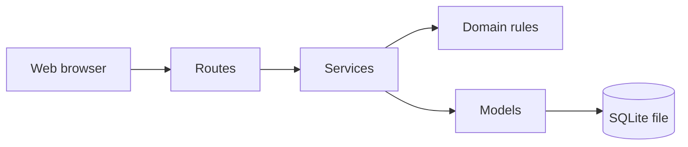

# Textile Quality Intelligence

A local application for recording textile quality inspections, defects, product disposition and corrective actions, and for reviewing quality results over time.

## Overview

Textile Quality Intelligence keeps inspection records in one place. For each inspection it stores what was inspected, which defects were found, what happened to the inspected quantity (accepted, rework, rejected or pending) and what was done to prevent the problem from returning.

It runs on one computer in a web browser. The data stays in a single file on that computer. No internet connection or cloud service is needed after installation.

## The Problem

Quality inspection results are often kept in paper forms, spreadsheets and separate files. This causes practical problems:

- The same defect is named in different ways, so counts and comparisons are unreliable.
- The quantities do not add up. A lot of 1,000 meters is reported as 900 accepted and 50 rework, and nobody notices that 50 meters are unaccounted for.
- A missing disposition is read as "all accepted".
- Corrective actions are agreed in a meeting and then forgotten. Nobody checks whether they were finished on time.
- An action marked "done" is treated as "problem solved", although nobody checked whether the defect actually stopped.
- It is hard to answer simple questions, such as which defect appears most often for a product, or whether rejections are rising month by month.

## The Solution

The application gives each part of this process a structured record and checks the records as they are entered.

- Defect categories and severity labels are defined by you, so everyone uses the same words.
- The disposition quantities must add up exactly to the inspected quantity. If they do not, the record is not saved.
- An inspection without a disposition is shown as "not recorded". It is never counted as accepted.
- A corrective action moves through clear statuses. It can only be marked "Effective" after a follow-up assessment has been recorded.
- Reports are calculated from the saved records, and every report shows the filters it used.

## Key Capabilities

**Inspections**
- Record date, product or item reference, batch or lot, production stage, inspection type, inspector, inspected quantity and unit.
- Each inspection gets a code in the form `INS-YYYYMMDD-0001`.
- Search by code, product or batch. Filter by date, product, batch, stage and disposition status.
- Edit an inspection. Delete it only if nothing else is attached to it.

**Defects**
- Maintain your own defect categories and severity levels. No lists are built in.
- Record several defect entries per inspection, with quantity, unit, suspected cause and observations.
- A defect can be left without a severity. It is then shown as "Not classified".
- Categories and severities that are already in use can be deactivated, not deleted, so history stays intact.

**Disposition**
- One disposition record per inspection with accepted, rework, rejected and pending quantities.
- The four quantities must equal the inspected quantity, in the same unit.
- A running total is shown while you type.

**Corrective actions**
- Record the problem, suspected cause, confirmed root cause, action description, responsible person and target date.
- Optionally link an action to a specific defect entry of the same inspection.
- Statuses: Open, In progress, Completed awaiting follow-up, Effective, Not effective, Closed.
- Follow-up assessments are recorded with a date, result (effective, not effective or inconclusive) and evidence. Earlier assessments are kept as history.
- An action is overdue only if it is open or in progress and its target date has passed. An action with no target date is never overdue.

**Reports and dashboard**
- Inspection summary, defect analysis, disposition, trend (by day, week or month) and corrective actions.
- Filters for date range, product, batch, stage, defect category, severity and disposition status.
- Quantities in different units are never added together.
- Rework and rejection rates use only inspections that have a disposition record. When there is nothing to divide by, the report shows "Not applicable" instead of 0%.
- The number of defect entries and the total defect quantity are shown separately, because one item can have several defect entries.

**Data management**
- Database status page with an integrity check.
- One-click backup. Backups are checked after they are written and never overwrite an older backup.
- Restore from the command line.

## How It Works

**Input**: an inspector records an inspection, with defect entries if defects were found.

**Process**: the application checks the entries. Units must match, quantities must be whole numbers above zero, and disposition quantities must add up. Records that fail a check are not saved, and the form shows what to correct.

**Output**: saved records, lists, a dashboard and reports.

A typical sequence:

1. Record the inspection: product, batch, stage, inspected quantity and unit.
2. Add the defects found: category, severity, affected quantity and observations.
3. Record the disposition: how much was accepted, sent for rework, rejected or is still pending.
4. If a defect needs follow-up, raise a corrective action from that defect.
5. Update the action as work progresses. When it is completed, record a follow-up assessment later to show whether it worked.
6. Open the dashboard and reports to review defects, dispositions and open actions.

## System Architecture

The application is a small web server that runs on the user's computer. The browser talks to it, and it reads and writes one SQLite database file.



- **Routes** (`app/routes`) receive the request and show the page. They contain no business rules.
- **Services** (`app/services`) do the database work, such as saving an inspection and building reports.
- **Domain rules** (`app/domain`) hold the checks: input validation, disposition reconciliation, corrective-action status rules and rate calculation. They do not depend on Flask or the database, so they can be tested alone.
- **Models** (`app/models`) describe the database tables.
- **Templates** (`app/templates`) and **static files** (`app/static`) produce the pages, styles and small browser scripts.

## Technology Stack

| Technology | Purpose |
| --- | --- |
| Python 3.12 | Programming language |
| Flask 3 | Web framework |
| Jinja | Page templates |
| SQLite | Database, stored in a single file |
| SQLAlchemy 2 with Flask-SQLAlchemy | Database access |
| Flask-Migrate (Alembic) | Creates and updates the database schema |
| Flask-WTF | Protection against forged form submissions (CSRF) |
| CSS and a small amount of JavaScript | Page design, adding defect rows, unsaved-change warning |
| pytest and Ruff | Tests and code checks |

## Installation and Setup

### Prerequisites

- Python 3.12 from [python.org](https://www.python.org/downloads/). Python 3.11 to 3.13 should also work. On Windows, tick "Add python.exe to PATH" during installation.
- A current desktop web browser.
- Internet access once, to install the packages.

### Install and start (Windows Command Prompt)

Run these commands in the project folder, the one that contains `run.py`:

```bat
python -m venv .venv
.venv\Scripts\activate
python -m pip install --upgrade pip
pip install -r requirements.txt
flask --app run db upgrade
python run.py
```

Open <http://127.0.0.1:5000> in your browser. Stop the server with `Ctrl+C`.

### Install and start (macOS and Linux)

```bash
python3 -m venv .venv
source .venv/bin/activate
pip install -r requirements.txt
flask --app run db upgrade
python run.py
```

### Starter data (optional)

The application starts with no defect categories or severity levels. To add a few examples:

```bat
flask --app run seed-reference
```

This adds the categories Hole, Stain, Shade variation, Stitching defect and Measurement deviation, and the severity labels Minor, Major and Critical. They are examples only. Edit them to match your own procedures.

### Configuration

Settings are read from environment variables. The application does not read `.env` files. All settings are optional for local use.

| Variable | Default | Meaning |
| --- | --- | --- |
| `TQI_ENV` | `development` | `development`, `testing` or `production` |
| `TQI_SECRET_KEY` | Generated once and saved in `instance/.secret_key` | Required when `TQI_ENV` is `production` |
| `TQI_DATABASE_PATH` | `instance/textile_quality.db` | Location of the database file |
| `TQI_DEBUG` | `0` | Set to `1` for Flask debug mode (development only) |
| `TQI_PORT` | `5000` | Port used by `python run.py` |
| `TQI_LOG_LEVEL` | `INFO` | Logging level |

In Command Prompt, set a value for the current window with, for example, `set TQI_PORT=5050`.

## Usage

### In the browser

| Page | What you do there |
| --- | --- |
| Dashboard | See the last 30 days (or a period you choose): inspections, defect entries, dispositions, overdue actions |
| Inspections | Search, filter and open inspections. Use "New inspection" to record one, with defects on the same form |
| Defects | See all defect entries. Manage defect categories and severity levels |
| Corrective Actions | Create and update actions, change status, record follow-up assessments |
| Reports | Choose a report, set filters and run it |
| Data Management | Check the database and create a backup |

On an inspection page you can add or edit defects, record the disposition and raise corrective actions.

### Command line

Run these in the project folder with the virtual environment active.

| Command | Purpose |
| --- | --- |
| `flask --app run db upgrade` | Create or update the database tables |
| `flask --app run seed-reference` | Add the example categories and severity labels |
| `flask --app run db-status` | Show file size, integrity check and schema state |
| `flask --app run backup` | Create a verified backup in `instance/backups` |
| `flask --app run restore-backup <file>` | Replace the current database with a backup |

Restoring replaces the whole database. Stop the application first. The command checks the backup before using it and keeps your current database as `textile_quality.db.pre-restore-<timestamp>`.

### Running the tests

```bat
pip install -r requirements-dev.txt
pytest
ruff check .
```

The unit tests cover the business rules, configuration, backup and restore, and page rendering. The integration tests use a temporary database. They cover saving and rollback, foreign-key enforcement, restricted deletes, the corrective-action workflow, report figures, CSRF protection, escaping of user text, and that the migration matches the models.

## Project Structure

```
app/
  __init__.py          Application factory
  config.py            Settings from environment variables
  cli.py               Command-line commands
  errors.py            Error pages
  domain/              Business rules without Flask or database code
  models/              Database tables
  services/            Database operations and report queries
  routes/              Page handlers, one file per area
  templates/           HTML templates
  static/              CSS and JavaScript
migrations/            Database schema migrations
tests/
  unit/                Tests that need no database
  integration/         Tests that use a temporary database
instance/              Local database, backups and secret key (not committed)
run.py                 Starts the local server
```

## Current Status

This is an early version. The features listed under Key Capabilities are implemented.

Design decisions in this version:

- Quantities are whole numbers. Units are free text, with pieces, meters, yards and kg suggested, and are stored in lower case.
- Each inspection has one disposition record. Multi-stage outcomes, such as reworked and then accepted, are not modelled.
- Severity levels and defect categories are labels. They do not carry acceptance limits or sampling rules.
- The completion date of a corrective action is entered by the user.

Not included:

- Login, user accounts and roles. The server listens on `127.0.0.1` only and is meant for one user on one computer. Do not expose it to a network.
- An audit trail of who changed what.
- Import and export of CSV or Excel files.
- Charts.
- Photos or file attachments.
- Acceptance sampling plans (such as AQL) and standards-based decisions.
- Restore from the browser. Restore is command line only, by design.

Timestamps are stored and shown in UTC. SQLite suits one local user and a moderate amount of data.

## Roadmap

These are ideas, not commitments:

- CSV or Excel export of lists and reports.
- Charts for defect and trend reports.
- User accounts and an audit trail for shared use.
- Photo attachments for defects.
- Printable inspection and report layouts.
- Optional support for sampling plans and acceptance limits.

## Contributing

Contributions are welcome.

1. Fork the repository and create a branch.
2. Set up the project as described above, with `pip install -r requirements-dev.txt`.
3. Keep business rules in `app/domain` and database work in `app/services`. Keep routes thin.
4. Add or update tests for your change.
5. Run `pytest` and `ruff check .` before opening a pull request.
6. In the pull request, describe what changed and why.

Please open an issue first for large changes or new features.

## License

Released under the MIT License. See [LICENSE](LICENSE).
